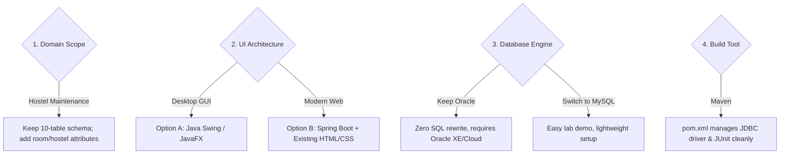
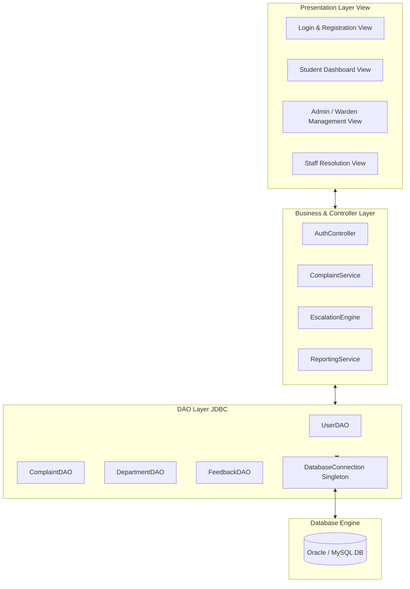
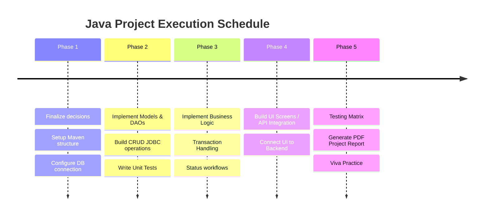

# Hostel Complaint & Maintenance Management System
## Java Project Conversion Guide: Architectural Decisions & Implementation Steps

---

## 1. Evaluation Rubric Breakdown

Your project is evaluated on **15 Marks** before EST:

| Component | Marks | Key Deliverables Required |
|---|:---:|---|
| **Complete Execution & Submission** | **10** | • **Problem Definition**: Clear scope, user roles, hostel domain context. • **System Design**: 3-tier architecture, UML Class Diagram, ER Diagram. • **Functionality**: Complete CRUD lifecycle, authentication, role workflows. • **Database Integration**: JDBC connection pooling, `PreparedStatement`, transaction handling. • **Testing**: JUnit test suite, manual test case execution matrix. • **Documentation**: Comprehensive `README.md`, setup guide, inline code comments. |
| **Viva-Voce & Project Report** | **5** | • **Project Report**: Formal academic report (SRS, diagrams, code, screenshots). • **Viva-Voce**: Clear explanation of OOP principles, JDBC, concurrency, exception handling, and SQL optimization. |

---

## 2. Key Decisions Matrix (Decide with Your Team)

Before writing Java code, make the following 4 decisions:

### Decision 1: Project Domain Scope
* **Option A (Recommended): Hostel Complaint & Maintenance Management System**
  * *Rationale:* 100% compatible with your existing 10 Oracle tables (`users`, `department`, `staff`, `complaint`, `complaint_assignment`, `complaint_feedback`, `complaint_escalation`, etc.). Departments naturally map to Hostel maintenance wings: **Electrical, Plumbing, Wi-Fi / Network, Carpentry, Mess / Food, Housekeeping**.
  * *Schema tweak:* Add a `room_number` / `hostel_block` column to the `users` table.
* **Option B: Full Hostel Management (Rooms, Fee, Mess, Complaints)**
  * *Warning:* Requires creating 4–6 additional tables from scratch (Hostel Fees, Room Allocation, Mess Rebate). Only choose if your professor explicitly demanded room allocation features.

---

### Decision 2: UI & Architecture Choice

| Parameter | Option A: Desktop Swing / JavaFX (Recommended for Core Java) | Option B: Spring Boot Web (Recommended for Enterprise/Web) |
|---|---|---|
| **Target Course** | Core Java / Object Oriented Programming (OOP) | Advanced Java / Web Technology |
| **Tech Stack** | Java SE 17/21 + Swing / JavaFX + JDBC | Spring Boot 3.x + Spring Web + Existing HTML/CSS/JS UI |
| **Evaluator Perception** | Proves direct command of OOP, event listeners (`ActionListener`), layouts, and pure JDBC | Impresses with modern REST API architecture and visual appeal |
| **Demo Setup** | **Zero server dependency**; runs directly inside IntelliJ / Eclipse or as a standalone `.jar` | Requires running local server on port `8080` + browser |
| **Frontend Effort** | Build 4–5 Swing frames (Login, Dashboard, Complaint Form, Admin Table) | Connect existing `frontend/index.html` & `app.js` to REST endpoints |

---

### Decision 3: Database Engine (Oracle vs MySQL)
* **Keep Oracle Database:**
  * Uses your existing SQL script directly with `ojdbc8.jar`.
  * *Prerequisite:* Oracle XE or local/cloud Oracle instance must be running during the demo.
* **Switch to MySQL:**
  * Very easy to demonstrate on any lab laptop via XAMPP or local MySQL.
  * *Conversion effort:* Minor syntax changes (`NUMBER` $\rightarrow$ `INT`, `VARCHAR2` $\rightarrow$ `VARCHAR`, sequence $\rightarrow$ `AUTO_INCREMENT`).

---

### Decision 4: Build Tool
* **Use Apache Maven (`pom.xml`)**:
  * Automatically downloads the JDBC driver (`ojdbc8` or `mysql-connector-j`) and JUnit 5 dependencies without manually copying `.jar` files into the project classpath.

---

## 3. Recommended 3-Tier System Design

To secure full marks under **System Design**, your project will implement the **Model-View-Controller (MVC) + Data Access Object (DAO)** pattern:

### Layer Responsibilities:
1. **Model Layer (`com.hostel.model`):**
   * Pure POJOs with encapsulated private attributes, getters, setters, and constructors:
   * `User.java`, `Complaint.java`, `Department.java`, `Staff.java`, `Feedback.java`, `Escalation.java`.
2. **Data Access Layer (`com.hostel.dao`):**
   * Interfaces (`ComplaintDAO.java`) and implementations (`ComplaintDAOImpl.java`).
   * Pure JDBC operations utilizing `PreparedStatement` to prevent SQL injection and `try-with-resources` for connection safety.
3. **Service Layer (`com.hostel.service`):**
   * Business validation rules:
     - Only complaints in `Assigned` status can be moved to `In Progress`.
     - Only the creator student can submit ratings and feedback.
     - Auto-escalation checks if complaint resolution SLA exceeds 48 hours.
4. **Presentation Layer (`com.hostel.view` or `com.hostel.controller`):**
   * Responsive GUI windows or REST endpoints interacting with the user.

---

## 4. Step-by-Step Implementation Roadmap

### Phase 1: Project Setup & Database Connection
- [ ] Initialize standard Maven directory structure (`src/main/java`, `src/main/resources`, `src/test/java`).
- [ ] Configure `pom.xml` with dependencies (JDBC driver, JUnit 5, HikariCP/Connection Pool).
- [ ] Implement `DatabaseConnection.java` implementing the **Singleton Pattern** and connection testing.

### Phase 2: Domain Entities & DAO Layer
- [ ] Create Model classes: `User`, `Department`, `Staff`, `Complaint`, `Feedback`.
- [ ] Implement `UserDAO`: User authentication, role verification (Student vs Warden vs Staff).
- [ ] Implement `ComplaintDAO`:
  - `createComplaint(Complaint c)`
  - `getComplaintsByUserId(int userId)`
  - `getAllComplaints()` (with filtering by status, priority, department)
  - `assignStaff(int complaintId, int staffId)`
  - `updateStatus(int complaintId, String newStatus)`
- [ ] Implement `FeedbackDAO` & `AnalyticsDAO` (summary statistics for dashboard).

### Phase 3: Transaction Control & Business Logic
- [ ] Add explicit JDBC transaction handling:
  - When status changes, update the `complaint` table AND insert an audit record into `complaint_status_history` in a single transaction with `conn.setAutoCommit(false)`, `conn.commit()`, and `conn.rollback()` on error.
- [ ] Implement input validation (e.g. valid phone numbers, non-empty titles, valid rating bounds 1–5).

### Phase 4: User Interface Implementation
* **If Swing (Desktop):**
  - `LoginFrame.java`: Role selector, credentials input.
  - `StudentDashboardFrame.java`: File new complaint, view my complaints table, give feedback modal.
  - `AdminDashboardFrame.java`: High-level metrics (Total, Pending, Resolved), assign staff dropdown, filter table.
* **If Spring Boot (Web):**
  - Implement `@RestController` classes exposing `/api/complaints`, `/api/auth`, `/api/stats`.
  - Wire existing `frontend/index.html` `fetch()` calls to these endpoints.

### Phase 5: Testing (Mandatory for Rubric)
- [ ] **Unit Tests:** JUnit tests verifying DAO CRUD methods and invalid input handling.
- [ ] **Manual Test Case Matrix:** Prepare a table of 10+ test cases covering:
  - Valid & invalid logins
  - Complaint submission with boundary edge cases
  - Role-based access control validation
  - SQL injection attempt verification (demonstrating `PreparedStatement` resilience).

### Phase 6: Project Report & Viva-Voce Preparation (5 Marks)
- [ ] **Project Report Structure:**
  1. Title Page & Certificate
  2. Problem Definition & Scope
  3. System Requirements Specification (SRS)
  4. Architectural Design & UML Class Diagram
  5. Database Design (Normalized Schema & ER Diagram)
  6. Detailed Functionality & Java Code Snapshots
  7. Test Cases & Execution Screenshots
  8. Conclusion & Future Scope
- [ ] **Viva Cheat Sheet:** Key questions evaluators ask:
  - *Why `PreparedStatement` over `Statement`?* (Pre-compilation + SQL injection immunity).
  - *What design patterns did you use?* (Singleton for DB connection, DAO pattern for persistence, MVC for separation of concerns).
  - *How did you ensure data integrity?* (Database constraints + JDBC transactional `commit`/`rollback`).
  - *Which OOP concepts are demonstrated?* (Encapsulation in POJOs, Abstraction via DAO interfaces, Polymorphism via event handlers).
