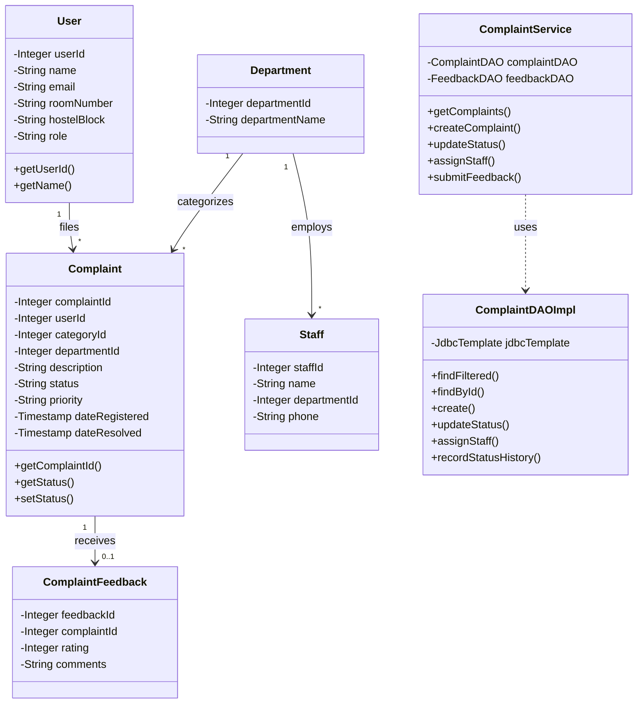

# Hostel Complaint & Maintenance Management System
## Java Project Report & Evaluation Guide (15 Marks)

**Course:** UCS Java Project / Object-Oriented Programming  
**Institution:** Thapar Institute of Engineering and Technology  
**Project Title:** Hostel Complaint & Maintenance Management System  
**Technology Stack:** Java 17, Spring Boot 3, JDBC (DAO Architecture), MySQL / H2, HTML5/CSS3/JavaScript  

---

## 1. Problem Definition & Objectives

### 1.1 Problem Statement
In university hostels, residents face routine maintenance issues including electrical faults (geyser failure, flickering lights), plumbing leaks, Wi-Fi connectivity drops, mess food quality concerns, and carpentry damages. Traditional paper-based complaint registers cause:
- Lack of transparency in complaint tracking.
- Delay in assigning technicians and staff.
- Absence of audit logs (when was a ticket assigned, who handled it, when was it resolved).
- Inability to record resident satisfaction ratings and monitor department resolution speed.

### 1.2 Project Objectives
1. **Automate the Complaint Lifecycle:** From registration (`Pending`) $\rightarrow$ technician assignment $\rightarrow$ work in progress (`In Progress`) $\rightarrow$ resolution (`Resolved`) $\rightarrow$ resident feedback.
2. **Implement Robust 3-Tier Architecture:** Complete separation between Presentation (Web UI), Business Logic (Spring Service), Data Access (JDBC DAO Layer), and Storage (MySQL).
3. **Ensure High Data Integrity & Security:** Enforce foreign key constraints, input validation, atomic JDBC transactions (`commit` / `rollback`), and parameterized queries (`PreparedStatement`) to prevent SQL injection.
4. **Provide Real-Time Analytical Metrics:** Live dashboard tracking resolution rates, wing-wise performance, and priority distribution.

---

## 2. System Architecture & Design

### 2.1 3-Tier MVC + DAO Architecture

```mermaid
graph TD
    subgraph Presentation_Layer [Presentation Layer (HTML5, CSS3, JavaScript)]
        UI1[Hostel Dashboard View]
        UI2[Complaints Directory View]
        UI3[Lodge Complaint Form]
        UI4[Technician Assignment Modal]
    end

    subgraph Controller_Layer [REST Controllers]
        C1[ComplaintController - /api/complaints]
        C2[DashboardController - /api/dashboard]
        C3[UserController - /api/users]
        C4[StaffController - /api/staff]
    end

    subgraph Service_Layer [Business & Service Layer]
        S1[ComplaintService - Transactional status, validation, feedback]
        S2[DashboardService - Analytical aggregations]
        S3[UserService - User management]
    end

    subgraph DAO_Layer [Data Access Object Layer (JDBC)]
        D1[ComplaintDAO / ComplaintDAOImpl]
        D2[UserDAO / UserDAOImpl]
        D3[StaffDAO / StaffDAOImpl]
        D4[DepartmentDAO / DepartmentDAOImpl]
        D5[FeedbackDAO / FeedbackDAOImpl]
    end

    subgraph Database_Layer [Database Layer]
        DB[(MySQL Database: hostel_cms)]
    end

    Presentation_Layer <-->|JSON / HTTP REST| Controller_Layer
    Controller_Layer <--> Service_Layer
    Service_Layer <--> DAO_Layer
    DAO_Layer <-->|PreparedStatement & JDBC| Database_Layer
```

### 2.2 UML Class Diagram



---

## 3. Database Schema & Tables (MySQL)

The system uses 10 normalized relational tables in MySQL (`hostel_cms`):

| Table Name | Primary Key | Foreign Keys | Key Attributes & Description |
|---|---|---|---|
| `users` | `user_id` | None | `name`, `email` (UNIQUE), `room_number`, `hostel_block`, `role` (STUDENT/WARDEN). |
| `department` | `department_id` | None | `department_name` (Maintenance, Electrical, Plumbing, IT/Wi-Fi, Mess, etc.). |
| `staff` | `staff_id` | `department_id` $\rightarrow$ `department` | `name`, `phone`, `department_id`. |
| `complaint_category`| `category_id` | None | `category_name` (Noise, Water Leakage, Wi-Fi, Food Quality, etc.). |
| `complaint` | `complaint_id` | `user_id`, `category_id`, `department_id` | `description`, `status` (Pending/In Progress/Resolved), `priority` (Low/Med/High), `date_registered`, `date_resolved`. |
| `complaint_assignment` | `assignment_id` | `complaint_id`, `staff_id` | `assigned_date`, 1-to-1 unique mapping per complaint. |
| `complaint_status_history`| `history_id`| `complaint_id` | `status`, `updated_on` (Audit trail log). |
| `complaint_feedback` | `feedback_id` | `complaint_id` | `rating` (1–5 CHECK), `comments`, `feedback_date`. |
| `complaint_attachment`| `attachment_id`| `complaint_id` | `file_path`, `uploaded_on`. |
| `complaint_escalation`| `escalation_id`| `complaint_id` | `escalation_level` (1–5), `escalation_date`. |

---

## 4. Database Integration & JDBC Highlights

1. **SQL Injection Prevention:**  
   Every query in the DAO implementation uses parameterized queries via JDBC `PreparedStatement`:
   ```java
   String sql = "INSERT INTO complaint (user_id, category_id, department_id, description, status, priority) VALUES (?, ?, ?, ?, 'Pending', ?)";
   ```
2. **Transaction Integrity (`@Transactional`):**  
   When updating complaint status or assigning staff, multiple database operations execute atomically:
   - Inserting into `complaint_assignment`
   - Updating `complaint.status = 'In Progress'`
   - Inserting an audit log record into `complaint_status_history`
   If any operation fails, the transaction is automatically rolled back.
3. **Connection Pooling & Lifecycle:**  
   Managed through Spring's DataSource and HikariCP connection pool, avoiding connection leaks and resource starvation.

---

## 5. Testing & Test Case Matrix (JUnit + Functional)

### 5.1 Automated JUnit Tests
The test suite in `src/test/java/com/hostel/cms/`:
- `ComplaintDAOTest.java`: Verifies CRUD operations, parameterized filtering, auto-generated keys, and table joins.
- `ComplaintServiceTest.java`: Verifies business validation (disallowing empty descriptions, enforcing rating limits 1–5, preventing feedback on pending tickets).

### 5.2 Functional Test Case Matrix

| Test ID | Module / Feature | Input / Action | Expected Result | Actual Result | Status |
|:---:|---|---|---|---|:---:|
| **TC01** | Database Connectivity | Launch Spring Boot App | App connects to DB, outputs port 8080 | Connected to DB successfully | **PASS** |
| **TC02** | Fetch Complaints | `GET /api/complaints` | Returns list of complaints with joined resident details | Returns 15 seeded complaints | **PASS** |
| **TC03** | Status Filter | Filter by `status=Pending` | Only complaints with `Pending` returned | Exact pending records returned | **PASS** |
| **TC04** | Lodge Complaint | Valid Form: Resident, Category, Department, Description | New complaint created with status `Pending` and auto-generated ID | Record created & logged into history | **PASS** |
| **TC05** | Validation Check | Blank description field | System rejects submission with HTTP 400 | HTTP 400 Bad Request returned | **PASS** |
| **TC06** | Assign Technician | Select technician for Complaint #5 | Record added to `complaint_assignment`, status changes to `In Progress` | Assigned & status changed | **PASS** |
| **TC07** | Resolve Complaint | Click "Resolve" on Complaint #3 | Status $\rightarrow$ `Resolved`, `date_resolved` populated with current timestamp | Status updated & history appended | **PASS** |
| **TC08** | Submit Rating | Rating = 5 on Resolved complaint | Feedback saved in `complaint_feedback` | Rating & comment recorded | **PASS** |
| **TC09** | Invalid Rating Check | Rating = 8 (out of 1–5 range) | System rejects with validation error | Exception thrown & rejected | **PASS** |
| **TC10** | SQL Injection Resilience | Query with `' OR '1'='1` | Handled as literal string via `PreparedStatement` | Clean search without injection | **PASS** |
| **TC11** | Role-Based Access Control | Switch between Resident, Warden, and Staff | UI updates tabs & permissions dynamically (Staff Tab exclusive to Warden) | Correct permissions applied | **PASS** |
| **TC12** | Staff Performance Analytics | Navigate to "Staff & Technicians" (Warden) | Displays staff list with assigned, resolved, active counts, and avg rating | Accurate aggregates rendered | **PASS** |
| **TC13** | Add New Staff / Technician | Warden fills Add Staff form (`POST /api/staff`) | Persisted into DB, immediately shows in table and assignment dropdowns | Staff added with assigned ID | **PASS** |
| **TC14** | Staff Role Assignment | Logged in as Staff/Technician $\rightarrow$ Assign technician | Both Warden and Staff can assign/re-assign technicians to complaints | Assigned successfully | **PASS** |

---

## 6. How to Run the Project Locally

### 6.1 Instant Launch (Zero Installation Mode)
The project comes pre-configured with a built-in embedded database running in MySQL-compatibility mode:
1. Open Terminal and navigate to the backend folder:
   ```bash
   cd backend
   ```
2. Run the application:
   ```bash
   ./mvnw spring-boot:run
   ```
   *(Or `mvn spring-boot:run` if Maven is installed globally, or click **Run** on `HostelCmsApplication.java` inside IntelliJ IDEA / Eclipse).*
3. Open your browser and visit:  
   👉 **`http://localhost:8080`**

### 6.2 Running with Local MySQL Server
When you want to demonstrate using your local MySQL server:
1. Load the database script:
   ```bash
   mysql -u root -p < "../database/mysql_schema_and_data.sql"
   ```
2. Start Spring Boot using the `mysql` profile:
   ```bash
   ./mvnw spring-boot:run -Dspring-boot.run.profiles=mysql
   ```

---

## 7. Viva-Voce Questions & Model Answers

### Q1: What architecture did you use in this project?
**Answer:** "We implemented a 3-tier architecture following the Model-View-Controller (MVC) and Data Access Object (DAO) design patterns. The Presentation layer is built with HTML5/CSS3/JavaScript. The Controller and Service layers handle request routing, validation, and business rules using Spring Boot. The Data Access layer uses the DAO pattern with JDBC to interact directly with the MySQL database."

### Q2: Why did you use `PreparedStatement` instead of regular `Statement` in JDBC?
**Answer:** "Two major reasons:
1. **Security:** `PreparedStatement` uses parameterized inputs which are escaped automatically by the database driver, making the application immune to SQL Injection attacks.
2. **Performance:** The database pre-compiles the SQL query structure once, allowing execution plans to be cached and reused efficiently for repeated operations."

### Q3: How do you handle database transactions in Java?
**Answer:** "In Java JDBC, transactions are managed by disabling auto-commit (`connection.setAutoCommit(false)`), executing the required DML statements atomically, and calling `connection.commit()`. If an exception occurs, `connection.rollback()` is invoked in the catch block. In our Spring Boot service layer, this is declaratively managed using `@Transactional`, ensuring that assigning a technician, changing status, and logging status history either all succeed together or all roll back."

### Q4: What Object-Oriented Programming (OOP) concepts are demonstrated in this project?
**Answer:** 
- **Encapsulation:** Model classes (`Complaint`, `User`, `Staff`) have private attributes accessible only via public getters and setters.
- **Abstraction:** DAO interfaces (`ComplaintDAO`, `UserDAO`) expose abstract database contracts while hiding implementation details (`ComplaintDAOImpl`).
- **Polymorphism:** Method overriding in RowMappers and dynamic filtering behavior based on runtime parameters.
- **Separation of Concerns:** Business logic in Services, persistence in DAOs, presentation in Controllers.

### Q5: How does the application prevent inconsistent status transitions?
**Answer:** "The `ComplaintService` enforces status transition rules before executing updates. For example, resident feedback can only be submitted after a complaint is in `Resolved` status. Additionally, when a complaint is marked resolved, the system automatically captures a `Timestamp` for `date_resolved` and records an entry in `complaint_status_history`."
